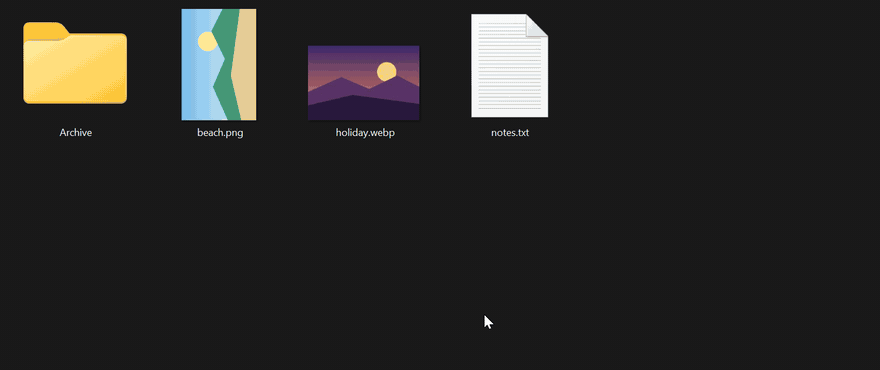
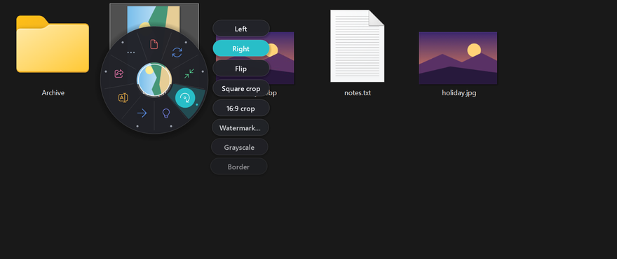
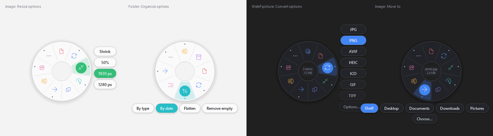
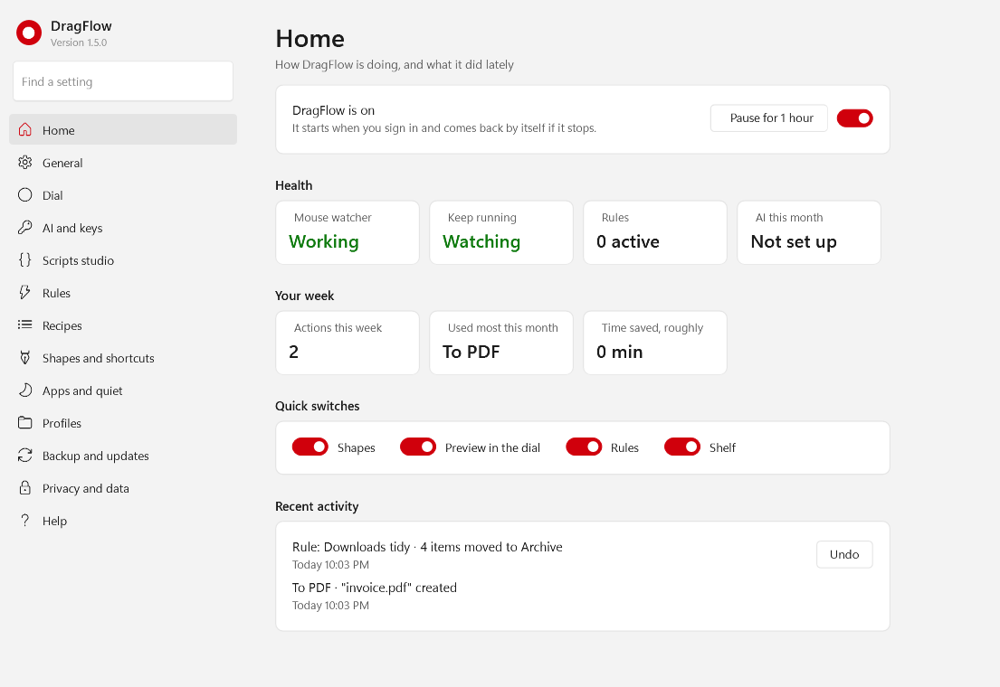

# DragFlow

**Actions for the files you drag.** Start dragging a file in File Explorer and a small dial of actions opens around it: convert, resize, zip, move, share and much more. Point at one and let go. To drag as usual, just keep moving: the dial gets out of the way.

Free and open source (MIT). Made for Windows 11; Windows 10 should work too. No account, and nothing leaves your PC unless you pick an AI action with your own key.

## Install

Download **DragFlow-Setup.exe** from the [latest release](../../../releases/latest) and run it. It installs for you only and needs no administrator rights. Updating works the same way; your settings are kept.

DragFlow is not code-signed yet, so Windows SmartScreen may say it doesn't know the publisher: choose *More info* › *Run anyway*. Each release lists the SHA-256 checksum of every file, so you can check your download with `Get-FileHash`.

To remove it, use **Settings › Apps › Installed apps › DragFlow › Uninstall** in Windows. It asks whether to keep your settings.

## Using it

| You want to | Do this |
|---|---|
| Run an action on a file | Start dragging it in Explorer or on the desktop, point at a slice, let go |
| Pick an option (for example Convert › WebP) | Rest on the slice; its options fan out beside it |
| Drag as usual | Keep moving. A quick flick never shows the dial |
| Skip the dial once | Hold **Alt** when you start dragging, or press **Esc** |
| Copy instead of move | Hold **Ctrl** over *Move to* |
| Choose without aiming | Press **1**–**9** while the dial is open |
| Use the dial without dragging | Select files, press **Ctrl+Alt+D**, or right-click › **DragFlow actions**, or right-click › **Send to › DragFlow**. Copied files work too: copy them, then press Ctrl+Alt+D with no Explorer window in front |
| Find an action by name | Type its first letters while the dial is open (shortcut dial) |
| Skip the dial for a favourite | After the dial has gone, draw a quick **Z**, **V**, **L** or **N** while dragging; that action appears beside the pointer: move onto it and let go |
| Send files to your phone | **Open & share › To phone**, then scan the QR code with the phone (same Wi-Fi) |
| Park files for later | Drop them on the **shelf** that appears at the right edge of the screen while you drag; drag them out later |
| Undo anything | **Undo** on the notification, the tray icon's **Undo** menu, or **Activity…** |

## What it can do

- **Pictures:** convert between JPG, PNG, WebP, AVIF, HEIC, GIF, TIFF, BMP and ICO in both directions. WebP, HEIC and AVIF lead with *To JPG*. *Convert › Options…* adds quality, resizing, a "no bigger than … KB" target and where to save. Also resize, to PDF, copy text (OCR), remove photo info, set as wallpaper, and under **Edit**: rotate, crop to square or 16:9, watermark, grayscale, border, collage, animated GIF.
- **Video and audio** (with ffmpeg installed): MP4, WebM, MOV, MKV, GIF, MP3, M4A, WAV, FLAC, OGG and Opus; resolution, quality and bitrate; trim; even out volume; thumbnails. Under **Tools**: compress to a size in MB, rotate, change speed, merge, contact sheet, burn in subtitles; for audio, fade, merge, speed, trim silence.
- **Web pages and text:** saved pages, `.url` shortcuts and text files to PDF, or to one long JPG or PNG. Text **Tools**: line endings, UTF-8, tidy JSON, sort or de-duplicate lines, Markdown to HTML.
- **Documents:** Word, Excel and PowerPoint files to PDF (through Office, or LibreOffice).
- **PDFs:** pages to PNG or JPG, copy text, combine.
- **Archives:** extract here or into a folder (zip, 7z, rar, tar…).
- **Folders:** sort by type or date, flatten, remove empty folders, find duplicates, size report, zip, list the contents as a spreadsheet.
- **Everything:** rename (with patterns and a preview), move or copy to recent and open folders, copy here, new folder, open with, share, e-mail, print, properties, desktop shortcut, compare two files, Recycle Bin.
- **Smart:** name files by what is in them (photo dates, document titles, invoice numbers), number photos by date, find look-alike photos. With the optional **AI helper** (your own Anthropic API key): AI name, summary, describe, translate, table to spreadsheet, Ask AI, e-mail draft.
- **Send and protect:** to your phone by QR code, a OneDrive share link, password encryption, checking a download's checksum.

## Always there

DragFlow starts when you sign in. If it ever stops without being asked to (a crash, or ended in Task Manager), a small guard starts it again within seconds. To turn it off, choose **Exit** in the tray menu: it asks whether it stays off until you sign in again, or for good.

## Making it yours

Everything is in the **dashboard**: double-click the tray icon, or choose Settings… in its menu. Changes save at once, with Undo; the search box at the top finds any setting.

What you can set there:

- **Smart:** the dial learns how you drag and puts your favourite actions first. *Show it more / less* and *Reset* are there too.
- **Quiet:** stay hidden in full-screen apps, while certain programs run, or in certain folders. The tray menu can also pause DragFlow for an hour.
- **Profiles:** different actions first for particular folders or programs.
- **Actions:** untick anything you never use.
- **Custom actions:** your own programs on the dial.
- **Rules:** "when a new PDF lands in Downloads, move it to Documents\PDFs" — done by itself, every time, undoable. Add "older than 30 days" or "bigger than 100 MB", and the rule also looks at what is already there once an hour (or now, with a button).
- **Recipes:** several actions as one ("resize to 1920 px › remove photo info › zip").
- **Look:** light or dark, a larger dial, animations off. Windows high contrast is followed automatically.
- **Shortcuts & updates:** the keyboard shortcut, the right-click entry, and where new versions are published.
- **AI & more:** the AI helper and its key, the shapes and their actions, pen and touch, the preview, the scripts folder (PowerShell, Python or batch scripts become dial actions), and saving your last actions as a recipe.
- **Backup:** keep the settings in a folder of your choice (a OneDrive folder gives you the same DragFlow on every PC), or back them up to a file and restore them.

## Safe by design

- Most actions make new files and leave the originals alone. Only renaming, moving, organising (sort, flatten, duplicates) and rotating change existing files. All of it, and everything else, can be undone for 7 days.
- Nothing is deleted for good: undone results, and the *Recycle Bin* action, go to the Recycle Bin. On a drive without one (a USB stick, a network share) they go to a "DragFlow removed" folder on that drive instead.
- DragFlow refuses to change Windows or Program Files, or to reorganise a whole drive.
- Long jobs show progress and can be cancelled; what was done so far can still be undone.

## For developers

- Build: `scripts\build.cmd` (uses the C# compiler in Windows; run `scripts\get-compiler.ps1` once for the modern Roslyn compiler).
- Tests: `bin\DragFlow.Tests.exe` (about 615 checks, run in a throwaway folder; needs ffmpeg, Excel and Python with OpenCV for a few of them, otherwise they are skipped; `--tier7` runs only the newest; `--dashboard <folder> [dark]` saves a picture of every dashboard page), and `tests\e2e-drag.ps1` (drives the real mouse for about a minute, 18 checks).
- Release: `scripts\release.ps1 -Notes "…" [-Publish <folder>] [-CertThumbprint <thumbprint>]` makes `bin\release\<version>` with the app, the installer, `latest.ini` for the updater and `SHA256SUMS.txt`. On GitHub, pushing a tag such as `v1.5.0` does the same and makes a draft release (`.github\workflows\release.yml`). Signing needs a code-signing certificate (from a certificate authority, or Azure Trusted Signing); without one, Windows SmartScreen warns people who download it.
- Translations: `scripts\translations.ps1` writes `docs\translations\template.txt`.
- Demo GIF: `scripts\record-demo.ps1` records `docs\images\demo.gif` with the real mouse in a real Explorer window (needs ffmpeg).
- Bugs and ideas: please open an issue; the forms ask for what's needed.
- The plan and the status of every item: [PLAN.md](PLAN.md). Changes: [CHANGELOG.md](CHANGELOG.md). Privacy: [PRIVACY.md](PRIVACY.md).

## License

MIT: see [LICENSE](../LICENSE).
